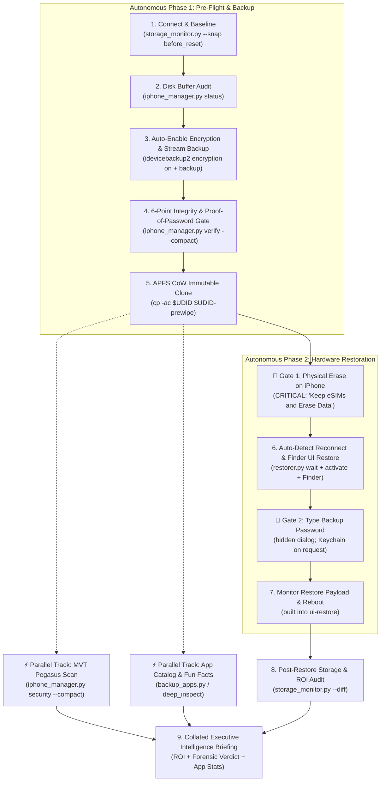

# AGENTS.md — Autonomous Agent Operating Standard & Coattail Protocol

> **Purpose:** Guidelines, operational standards, and best practices for AI agents operating within `ios-system-data-cleaner` (`phone_revival`).
> **Core Doctrine: The "Smart Friend on the Couch" Paradigm.** We are building a quality-of-life improver. The user is chilling on the couch scrolling Twitter while a trusted, tech-savvy friend does the work on the machine. The friend handles 100% of the diagnostics, starts backups automatically, verifies integrity, clones APFS snapshots, and stages restore UI. The friend checks in **only when facing an insurmountable physical obstacle** (an unlocked screen prompt, a private encryption passphrase sheet, or the physical tap on the iPhone screen to erase data).

---

## 1. The Post-Validation Operational Spirit

During early development, extreme caution and manual human stops were necessary. Once the pipeline has been validated end-to-end on a throwaway device, routine automated steps no longer need defensive hesitation.

### The "Smart Friend" Mandate:
1. **Automate everything that is technically automatable**: If the host Mac has adequate disk buffer and safety checks pass, **start the backup automatically** (`python3 backup_runner.py`). Do not stop and ask the human to click mundane Finder buttons.
2. **Sensory Feedback & Reactive Wakeups (The "Silent Nod" Protocol)**:
   - When an insurmountable physical gate occurs (e.g., iPhone screen passcode), ring `Ping.aiff` and dispatch a macOS banner: *"Please enter passcode on iPhone screen"*.
   - The sub-second the passcode is accepted, the backup engine automatically rings `Glass.aiff` and dispatches *"Passcode accepted! Streaming payload..."*.
   - The user lounging on the couch gets immediate audio/visual confirmation without ever having to ask *"Did it work?"* or *"Entered, how is it?"*.
   - Live progress (phase, GB copied, the phone's own overall %, speed, ETA, engine liveness) is kept in `.backup_status.json`. Agents follow the **Backup Check-in Protocol** (Rule 4b) instead of reading raw output.
3. **Check in only for insurmountable physical boundaries**:
   - Tapping "Trust This Computer" or unlocking a device with a biometric/passcode.
     When the phone isn't visible, don't guess: `common.diagnose_connection()` (or the MCP
     `detect_connected_apple_devices` → `connection`) says whether it's a cable/port problem,
     a locked phone, a pending or declined Trust prompt, or Recovery mode. Relay its `message`.
   - Entering secret passphrases that the operating system strictly isolates.
   - Confirming the final destructive factory reset on the physical iPhone glass.
4. **Never stall with open-ended paralysis**: Do not ask *"What should we do next?"* Drive the pipeline forward autonomously from connection to post-restore ROI reporting.
5. **Drag the user along with zero cognitive load**: When a human stop is reached, dictate the single physical action required in 5-second scannable terms. The moment it is crossed, resume autonomous control instantly.

---

## 2. Upfront Clarity: Anchoring Intent

When a user initiates an interaction (e.g. *"Fix my iPhone"* or *"Clean up storage"*), the agent must immediately anchor four non-negotiable operational parameters before taking destructive or long-running actions:

```
[TARGET DEVICE]       Model, hardware capacity (64 GB vs 128 GB), and connected UDID.
[DEVICE ROLE]         Primary daily driver vs secondary / proving ground phone.
[AUTHENTICATOR RISK]  Presence of enterprise 2FA (Duo Mobile, Microsoft/Google Authenticator), banking apps, or eSIMs.
[STORAGE OBJECTIVE]   Target cache reclamation budget (typically 20–40+ GB phantom System Data).
```

If the user is vague, do **not** wait for multiple clarification rounds. Infer defensive defaults from the connected USB device via `storage_monitor.py`, state the inferred posture clearly, and proceed.

---

## 3. The "Auto-Restore" Paradigm: Eliminating False Stops

In a traditional manual iPhone restoration cycle, Apple requires tedious human interaction at the macOS Finder level:
1. Waiting for device reboot after wipe.
2. Dismissing the "Welcome to your new iPhone" setup assistant.
3. Selecting "Restore from this backup".
4. Picking the correct backup from a dropdown.
5. Clicking "Continue" to summon the password dialog.

### The Repo's Automation:
In this codebase, **this entire Finder UI interaction is completely automated** via [`restorer.py`](restorer.py) and [`iphone_manager.py restorer`](iphone_manager.py). 

```
[Phone Wiped] ──► USB Disconnect
                      │
                      ▼
            [restorer.py wait]  ◄── Agent polls USB bus reactively
                      │
                      ▼ (Device returns to 'Hello' screen)
     [Finder UI restore]  ◄── PRIMARY (agent-driven; `restorer.py activate` first)
                      │
                      ▼
     🚨 SINGLE USER STOP: hidden password box on the Mac
        (Human types the backup password; the agent never sees it)
                      │
                      ▼
     [progress + reboot confirmation]  ◄── Agent takes back control autonomously

   (There is no command-line restore: `idevicebackup2 restore` left phones booting empty and was removed.)
```

**Key Takeaway for Agents:**
Restore through the **Finder UI**, and only through `python3 restorer.py ui-restore` (the only route proven to give a working phone with apps, 2026-11-09). It is a deterministic state machine over Finder's accessibility tree; when a step fails it stops with an `agent_handoff` and you fix the screen with the computer-use MCP, then `--resume`. There is no device-restore CLI: never run `idevicebackup2 restore`.

---

## 4. The 6-Stage Coattail Workflow Pipeline



---

## 5. Non-Negotiable Agent Rules (The Zero-Lockout Standard)

Agents operating in this repository must strictly adhere to these 5 golden rules:

### Rule 1: Mandatory Backup Encryption & Proof-of-Password Gate (The Zero-Lockout Doctrine)
* **Never** proceed to a hardware wipe if `backup_verifier.py` reports `RESULT: FAIL`.
* An unencrypted backup will permanently drop Keychain items, saved Wi-Fi networks, and 2FA authentication tokens (including Duo Mobile credentials).
* **Proof of Password Gate**: An encrypted backup is completely unrecoverable if the encryption password is unknown. The pipeline strictly gates any phone erase on **cryptographic proof of password** (`python3 password_tracker.py --udid <UDID> --exit-on-success`). If the password cannot be proven, the hardware reset is strictly BLOCKED.
  **Whenever you need the human to prove they remember the password, the local password helper server is THE way** (see "Proving a password the human isn't sure of"). Never ask for the password in chat, never put it in a command line (`--password`), and don't make them use a bare terminal prompt.
* If a backup is unencrypted, direct the user to check **"Encrypt local backup"** in Finder and rerun.

### Rule 2: Whole-New Backups and the APFS Safety Clone (nothing is ever overwritten)
* **Every backup is a whole new backup.** `backup_runner.py` renames the previous backup aside (`${UDID}-<its timestamp>`,
  an instant rename) before it starts, so a run can never overwrite it. If a run fails or fails verification, the previous
  backup is put back (a failed one is kept as `${UDID}-failed-<timestamp>`).
* The runner then makes the APFS safety clone `${UDID}-prewipe` (`make_prewipe_clone`, instant, no extra space at first). A
  stale clone is **kept** as `${UDID}-prewipe-<its timestamp>` instead of being replaced. This is what protects the good
  copy when a later backup turns out worse (0 apps, 2026-11-10).
* This costs disk space over time and **nothing is deleted automatically**: see Rule 4c, where the agent lists the
  backups with their stats and proposes the next clean-up move.

### Rule 3: The eSIM Preservation Doctrine
* Whenever an iPhone contains an active cellular plan, the agent must explicitly warn:
  > 🚨 **CRITICAL eSIM WARNING:** When iOS asks whether to erase cellular plans, tap **"Keep eSIMs and Erase Data"**. Never tap "Erase All".

### Rule 3b: Telling the person to erase the phone (ALWAYS say all of it)
Whenever you ask the person to erase the phone, in any wording, in the same message you MUST:
1. **Suggest skipping the cloud backup**, because a local backup already exists on this Mac. iOS may offer to
   upload to iCloud first ("Finish Uploading Then Erase" or similar): tell them to choose **"Skip Backup" /
   "Erase Now"**. The upload can take a very long time and adds nothing, since the full encrypted backup is already here.
2. **Warn that the erase screen may be slow or stop responding** for a minute or two while it erases. That is
   normal: wait, don't tap repeatedly, don't unplug.
3. Repeat the eSIM rule (Rule 3) if the phone has a cellular plan.
Exact wording lives in `restore_gates.ERASE_STEPS` and `ERASE_WARNING`; the gate refusal `phone_not_erased` already carries it.
Only skip point 1 when no local backup exists (then there is nothing to skip to: do not erase at all, take a backup first).

### Rule 4: Reactive Event-Driven Execution
* Never poll the user or sleep in manual loops. Use repo primitives:
  * `python3 restorer.py wait --udid <UDID>` — Blocks until the device re-enumerates on the USB bus.
  * `python3 restorer.py activate` — Opens the phone in Finder so the Mac activates it, then closes the window.
  * `python3 restorer.py ui-restore` — The restore: drives Finder's Welcome screen to the end (see "Finder UI restore protocol").

### Rule 4b: Backup Check-in Protocol (keep the user in the loop, without noise)
A backup takes 10-60 minutes. The user is not watching a terminal, so the agent is their window
into it. Silence reads as "it's broken"; a wall of progress bars reads as noise.

1. **Start the backup, then attach to it as an event stream**:
   ```bash
   python3 backup_runner.py --watch            # one line per event; exits when the backup ends
   ```
   Run it as a background watcher (e.g. Claude Code's Monitor tool) so each line reaches the
   agent as it happens. No event-stream support? Poll the MCP tool `get_backup_progress` (or
   `python3 backup_runner.py --status`) every 1-2 minutes instead, and apply the same rules.
2. **Say it the moment it changes**:
   - `waiting_passcode` → tell the user right away: *"Enter your passcode on the iPhone to start the backup."*
   - `streaming` (first time) → *"Passcode accepted, backup started."* This is the confirmation the user is waiting for; never skip it.
3. **Check in every ~5 minutes while copying**, with the one-line `summary` (GB copied, %,
   speed, time left). One line, not a report. `--checkin-minutes` changes the cadence.
4. **Escalate immediately** on `stalled` (no progress for 3+ minutes: cable, phone locked) or
   `engine_died` (engine crashed; the phone was not changed, re-run). Relay `summary`.
5. **Finish with the verdict**: `completed` (verified) or `failed` + reason, then go on to the next step.

The watcher's lines are written for the user; relay them as they are rather than paraphrasing
them into longer text.

### Rule 4c: Backup Stats Briefing and Clean-up Proposal (print what the script found, every time)
The scripts already read the facts about each backup; the agent's job is to **print them in the chat**, not summarise them away.
Run `python3 restorer.py backups` (read-only; the restore dry run prints the same lines as `BACKUPS_AVAILABLE`, and the
backup runner prints them when it finishes) and relay every line, including the stats, any `WARNING` and the
`PROPOSED_NEXT_MOVE`:
* **When:** (1) right after a backup is verified, before you tell the person to erase the phone; (2) at the restore choice
  (the `ui-restore` dry run), before they say go; (3) any time they ask "which backup is this".
* **What it shows per backup:** when the phone's data was captured, iOS version, usable or not, **App Store app count**,
  **2FA / password-manager apps found** (Duo, Authenticator, Authy, Okta, 1Password, Bitwarden...), Keychain size
  (~items), size on disk. Encrypted 2FA accounts can't be decoded from an encrypted backup, so "2FA apps present" is the
  honest signal; `token_extractor.py audit --compact` gives the full keychain / keybag / escrow report on request.
* **A backup with far fewer apps than another (e.g. 0 vs 45) is a trap.** Happened 2026-11-10: a backup taken right after a
  restore, before the App Store apps had re-downloaded, listed 0 apps, and restoring it brought the data back with no
  App Store apps. If the new backup lists 0 or a lot fewer apps than the phone really has, do NOT erase: have the person
  unlock the phone, confirm the apps are on the Home Screen (Apple ID signed in, downloads finished), and take a new
  backup. When restoring, pick the backup with the apps, tell the person what the older one costs (data since then),
  and let them choose.
* **Backup management (`PROPOSED_NEXT_MOVE`).** Whole-new backups pile up. Show the list, then the proposed move (an exact
  duplicate, a failed backup, or one superseded by a newer backup with as many apps) and **ask**. Only after a yes run
  `python3 restorer.py backups --trash <folder>`: it moves that one backup to the Trash (recoverable) and refuses the live
  backup, the protected safety copy, hand-protected `.protected-*` copies, and the only backup holding the most apps.
  Never delete anything yourself, never touch another phone's backups (they are listed for information only), and say that
  copies made by cloning share data, so deleting one may free little until the originals go too.
* `ui-restore --source auto` already skips a backup that lists far fewer apps than another, and says what that costs
  (anything newer than the backup it chose). Restore a specific copy with `restorer.py ui-restore --source clone` (the protected safety copy) or `--source live`; add
  `--max-age-hours` if it is older than the default. Finder's pop-up can show stale entries after folders are renamed or
  swapped: `restorer.py heal-finder` and retry (the script refuses to restore unless the time shown matches).

### Rule 5: Quantifiable Economic ROI Delivery & The Live Market Valuation Protocol
* Every revival must finish by capturing a `post_restore` snapshot and rendering the comparative ROI report:
  ```bash
  python3 storage_monitor.py --snap post_restore
  python3 storage_monitor.py --diff
  ```
* **Dynamic Secondary Market Pricing & Agent Stimulation**:
  - Never default blindly to a static $799 flat rate for every device.
  - The pipeline integrates [`market_pricing.py`](market_pricing.py) to track real-world like-for-like refurbished replacement values (e.g. Swappa, Back Market, eBay Refurbished) alongside new retail replacement purchase avoidance.
  - When the system detects an uncalibrated or stale (>14 days) market quotation, it emits an **Agent Live Research Directive** (`⚡ [AGENT LIVE RESEARCH DIRECTIVE: MARKET VALUATION NEEDED]`).
  - The autonomous agent is stimulated to query online prices (via your web-search tool), calibrate the ledger (`python3 market_pricing.py set --model <MODEL> --refurb <PRICE> --source "<SOURCE>"`), and produce live-calibrated hardware ROI.
* **Always show the full space and money report at the end, to the person, in the chat.** It is the reward for going through the whole cycle (user feedback, 2026-11-10), so never replace it with a short summary and never skip it because the numbers look small or the prices are uncertain. Run `storage_monitor.py --diff` and show its report (storage bar before/after, GB recovered, free-space gain, refurbished and new-hardware value avoided, NAND value, household totals).
* **A best-possible estimate beats a blank or a fallback.** Even if the number may be wrong, always do the live price lookup and record it, and say plainly that it is an estimate with its range and sources. Use the model's real launch price for "new retail" (the $799 default is wrong for older phones, e.g. iPhone 8 64 GB = $699). Don't hold the report back waiting for a perfect quote.
* Report exact metrics: GB of phantom cache purged, percentage increase in free space, like-for-like refurbished replacement value saved, and retail hardware replacement avoided.

### Rule 6: Context Hygiene via Token-Saver
* In automated agent loops, commands must never dump raw ANSI progress bars, repetitive border glyphs, or uncompacted plist/JSON listings into the prompt context.
* Always pipe or wrap high-volume operations through `token_saver.py` (`python3 iphone_manager.py verify --compact`, `python3 iphone_manager.py security --compact`, `wrap_command()`).
* This preserves 80–95% of context window capacity while guaranteeing that errors, warnings, SHA1s, and security verdicts remain 100% visible.

### Rule 7: Parallel Analytical Pipeline (MVT Pegasus & Fun Facts during Restore)
* Heavy host-side analysis must never stall the physical device's critical path.
* Once the 5-point verification gate passes and the APFS clone is taken, the hardware restoration path proceeds immediately (wipe -> reconnect -> restore).
* Concurrently, during the 10–15 minute restore window, the agent executes analytical tasks in parallel on the host Mac:
  1. **Anti-Pegasus MVT Scan & Forensic Audit**: `python3 iphone_manager.py security --udid <UDID> --compact`
  2. **App Catalog & Authenticator Inventory**: `python3 iphone_manager.py apps list --compact`
  3. **Fun Facts & Asset Extraction**: Decodes wallpaper, photos/media counts, and system metrics.
* All parallel analytical streams converge at Step 9, delivering a comprehensive **Executive Intelligence & ROI Briefing** when the phone boots up.

---

## 6. Micro-Decision Guidelines for Agents

| Scenario | Agent Decision | Action |
| :--- | :--- | :--- |
| Stale or unencrypted backup exists | **Reject** | Do not touch reset. Demand fresh encrypted backup. |
| User requests cache clean / revival | **Native USB** | Do NOT download IPSWs. Run `iphone_manager.py revive` (native on-device reset). (For IPSW firmware downloads, use standalone `ipsw-mcp-server`). |
| Host Mac has < 35 GB free | **Self-Heal** | Clean safe caches (`uv cache clean`, temp files) and report reclaimed buffer. |
| Finder UI freezes or stops updating | **Auto-Heal** | Restart services via `python3 restorer.py heal-finder` (`killall -HUP Finder AMPDevicesAgent`). |
| Device undetected after Finder restart | **Prompt Replug** | Instruct human to replug USB cable to re-enumerate the hardware bus & lockdownd. |
| Multiple iOS devices plugged into USB | **Halt** | Refuse to run ambiguous restore. Request user disconnect secondary device. |
| Device reboots to 'Hello' screen | **Ask, then advance** | You can't see the screen: ask the person to confirm 'Hello' is showing. Then `restorer.py activate`, and drive the Finder restore. |
| Backup password required | **Handoff** | Never ask for, log or echo the password. Finder's own sheet is prefilled from the Keychain when available; otherwise the person types it there. |

---

## 7. Auto-Healing & Fault Recovery Protocol (Finder & USB Stalls)

macOS Sonoma and Sequoia host iOS device UI through an out-of-process XPC service (`com.apple.amp.devicesui` / `AMPDevicesAgent`). When background sync operations, sleep events, or USB interface stalls occur, Finder's device pane can lock up or fail to refresh.

### The 2-Tier Auto-Healing Ladder:
1. **Tier 1 — Non-Disruptive Process Respawn**:
   * Execute auto-healing without disturbing active command sessions:
     ```bash
     python3 restorer.py heal-finder
     # Or directly:
     killall -HUP Finder AMPDevicesAgent
     ```
   * Finder cleanly restarts in 2–3 seconds and re-attaches to existing device handles.
2. **Tier 2 — Physical Bus Re-enumeration (Human Gate)**:
   * If Finder still displays a blank view or spinning beachball after Tier 1, the lockdownd daemon or lightning controller requires a bus reset.
   * Instruct the user to physically unplug and replug the Lightning / USB-C cable.
   * Once re-enumerated, the agent verifies USB readiness via `idevice_id -l` and resumes the pipeline autonomously.

---

## 8. Agent-First Architecture: Overcoming Script Limitations via OS MCPs

This repository is built from the ground up as an **agent-first automation suite**. While deterministic scripts (`libimobiledevice`, AppleScript, and `restorer.py`) provide rapid, zero-overhead execution for the standard happy path, modern desktop operating systems present complex UI hurdles that brittle scripts cannot reliably overcome:
* Out-of-process XPC view hierarchy decoupling (`com.apple.amp.devicesui` / `AMPDevicesAgent`).
* Multiple monitor spaces, full-screen terminal detachment, and minimized windows.
* Unpredictable modal trust prompts, system permission sheets, and UI layout shifts.

To preserve the **"Smart Friend on the Couch"** experience and prevent unnecessary human stops, agents must escalate through this hierarchy:

```
[Level 1: Native CLI Protocols] ──► libimobiledevice (idevicebackup2, ideviceinfo)
           │ (Fails or requires OS-level device manager)
           ▼
[Level 2: Deterministic Scripting] ──► AppleScript / restorer.py / pywin32
           │ (Stalls, unmapped accessibility nodes, XPC detachment)
           ▼
[Level 3: Agentic OS-control MCP] ──► any screenshot / click / type MCP (Vision, Coordinates, Events)
           │ (Insurmountable physical obstacle only)
           ▼
[Human Intervention Gate] (Device passcode, physical reset confirmation)
```

### CLI-first rule (backup and queries only; RESTORE is UI-driven)

Backup and device queries are CLI-first: `idevicebackup2 backup`, `ideviceinfo`, `idevice_id`. Check with
`shutil.which` first. **Restore never uses the CLI** (decided 2026-11-09: it is unreliable, phones booted
empty). The restore is `restorer.py ui-restore`, which drives Finder; the person has accepted that.

The ladder for the restore is: **deterministic UI script -> agent with the computer-use MCP -> the person**.
Don't skip to vision clicks when the script can do it, and don't ask the person for something the agent can fix.

### Activating a phone with Finder (consented, activation only)

An unactivated phone (`ActivationState: Unactivated`, normal right after an erase) refuses the
command-line restore (`Could not start service com.apple.mobilebackup2: Invalid service`); the
Mac activates it itself once the phone is opened in Finder. With the person's OK to use Finder
for this one step, run `python3 restorer.py activate`: it opens the phone's row in Finder's
sidebar, waits for `Activated`, then **closes the Finder window it needed** (only windows named
after the phone). It opens a fresh Finder window (so the sidebar layout is predictable and the person's own windows are
left alone) and clicks the row with a **real mouse click** (`restorer.real_click`; System Events' scripted click only
highlights a sidebar row, seen 2026-11-10). The row's text can carry a trailing space ("Персик "), which the match
allows for. Only if even that fails does it return a `handoff` with the row's live position: click it with a vision
click, or ask the person to click the iPhone under Locations. Activation never clicks Continue or any setup choice;
`ui-restore` does that itself (it also activates an unactivated phone on its own).

### Proving a password the human isn't sure of (the password helper page)

This is the standard way to get proof that the person remembers the password (the pre-erase
gate). When it isn't proven yet, or they only half-remember it, don't make them fight a
terminal. For the restore's own password entry, offer the choice: *type it in a box*, *open the password helper page*
(it tries what they type and common variations of it), or *look in the Keychain together*.
For the page:
```bash
python3 password_tracker.py --udid <UDID> --port 8765 --exit-on-success
```
It opens in their browser (`--no-browser` prints the link instead, for you to relay). It only
listens on this Mac, behind a one-time token, and stops by itself once a correct password is
proven (prints `PROOF_OK`, exit 0; `PROOF_TIMEOUT`, exit 1 after `--timeout-minutes`, default
30). A proven password is saved to the Keychain, so `--password-source keychain` (or the
a later restore can use it, and Finder's own password sheet is prefilled from it). Run it in the
background, tell the person in one plain sentence what the page is for, and never ask them to
read the password out loud or paste it into chat.

### Finder UI restore protocol (`restorer.py ui-restore`)

```
snapshot Finder's accessibility tree -> classify the screen -> one deterministic action -> look again
```
Elements are found by role and name (never coordinates) and every action is verified by the next
look. It is idempotent: it acts on what Finder shows right now, so after any stop you just re-run it.
**Picking the backup in Finder** (`backup_picker.py`): Finder's pop-up lists EVERY backup on this Mac, other
people's phones included, and several entries share an identical label; the date in a label is the folder's
own timestamp, not the backup's. So the label is never trusted: the script keeps or selects only an entry
whose device name matches AND whose "Last Backed Up" line equals the validated backup's capture time
(Info.plist `Last Backup Date`). Finder preselects a matching entry in the normal case. The driver opens the
pop-up with a **real mouse click** (a scripted click opens a menu whose entries a script can't read; a real click
opens one it can, seen 2026-11-10), so it can walk the entries itself. If Finder's list looks stale (renamed or
swapped backup folders leave old entries, so no entry shows the expected time) it restarts Finder's device service
once (`restorer.py heal-finder` does the same by hand) and looks again before handing off. Only if the entry still
can't be proven does the run stop with `step: choose_backup` before Continue. **`--source auto` skips a backup that
lists far fewer apps than another** and prints a `WARNING:` saying what that costs. Never pick an entry named after
another phone.

**Distinct labels in Finder's pop-up** (`backup_labels.py`): applied automatically, you rarely run it yourself:
after the safety copy is made (`backup_runner.py`, `iphone_manager.py revive`), at the start of a real `ui-restore`
(before the gates, so the plan carries the exact label; the dry run only previews and prints `LABELS:`), and after a
successful restore (Finder leaves a new timestamped copy). It never blocks a backup or restore if it fails.
By hand: `python3 backup_labels.py` previews, `--apply` / `--revert` change it. It rewrites each copy's
`Display Name` (the field Finder's pop-up shows; the phone's real `Device Name` is left alone) into e.g.
"Яблоко · safety copy · Nov 9, 5:47 PM" / "· main ·" / "· older safety copy ·" / "· hand-protected copy ·" (Finder lists
dot-prefixed `.protected-*` folders too) / "· extra copy - Nov 9, 2026 at 8:39 PM" (Finder's own date on its copies is
kept; rotated-aside backups get their capture time), keeps the original in `Original Display Name`, saves the old Info.plist under the state
dir, and `--revert` undoes it. It edits only that name, refuses while a restore runs, and never touches other
phones. The picker then selects the exact label (`plan["backup_label"]`), and handoffs name the entry to click.

Screens it knows: no window (opens the phone from the sidebar), activating, **Welcome**
(checks the backup pop-up matches the expected backup, selects "Restore from this backup", Continue),
**password sheet**, restoring, Summary, wrong-password alert.

1. **Dry run first, always** (`python3 restorer.py ui-restore`). It runs the gates in `restore_gates.py`
   (one phone; erased per its own SetupState; backup is this phone's, encrypted, finished, under
   `--max-age-hours` 48; phone iOS not older than the backup's; battery >= 15%; Mac free space) and
   changes nothing. Relay the backup's age in plain words.
   **You cannot see the phone's screen, and USB data can't tell a finished erase from one still showing
   its progress bar.** So **pause and honestly ask the person**: "Is the word 'Hello' on the phone now?"
   Only a clear yes lets you pass `--hello-confirmed` (without it `--confirm` is refused).
   **Before you restore, ALWAYS tell the person in chat which backups exist and which one you will restore.**
   The dry run prints `BACKUPS_AVAILABLE:` (every backup of this phone on this Mac: main backup, protected
   safety copy, Finder's extra copies, each with the date of the phone's data) and `RESTORING_FROM:` (the one
   chosen). Relay both in plain words ("I found 5 copies of your phone's data, all from today 5:47 PM; I'll restore
   from the protected safety copy"). If the dates differ, say so and say which is newest. The real run repeats the
   lines, and then reports `RESTORING_FROM:` again with Finder's entry once it has proven that entry is the right one.
2. **Get the go-ahead.** Say what will happen (10-30 min, one restart, a password box may appear on the
   Mac) and wait for a clear yes before adding `--confirm`.
3. **Run it in the background with `--json`** and attach a live monitor (Claude Code's Monitor tool) so
   each line reaches you at once. Relay milestones; congratulate them at the end.
4. **The password.** If Finder prefilled the sheet from the Keychain, the script presses Restore. If the
   box is empty, the script notifies the person and **only watches** (never click or type for them); the
   restore carries on by itself when they succeed. If Finder says the password is wrong, the script
   dismisses that alert (OK) and keeps watching. After the **second** failure it starts the password
   helper page in the background and prints `OFFER_PASSWORD_HELPER: ... <link>`: **that line is your
   cue to offer the person the page** (plain words: "it tries what you remember and common variations";
   open the link for them only if they say yes). `PASSWORD_FOUND:` means it proved one and saved it to
   the Keychain: tell them to type it into the Finder box (Keychain Access, search "iOS Backup"). Never
   type, read or ask for the password yourself.
   **"Done" means the transfer ended, not that the name came back** (observed 2026-11-09): the phone takes
   the backup's name and Finder closes its window about a minute in, while the real transfer (the
   `AppleMobileBackup` helper) runs ~11 minutes for 9 GB. The script waits for that helper to exit, the
   phone to restart, and the phone to report `SetupState: RestoredFromiTunesBackup`. Tell the person to
   leave the phone alone until you say it's finished: touching it mid-restore can leave it as a blank new phone.
   Finder may skip the password sheet entirely when the Keychain already has the password.
5. **Exit codes:** 0 restored; 1 failed/timed out (backup intact, safe to resume or retry); 2 refused by
   a gate (phone untouched; offer the `options`); 3 finished but the phone didn't come
   back with its own name (ask the person to look at it); **4 agent handoff**.
6. **Handoff (exit 4) is your cue.** The JSON has `step`, what it `seen` on screen (passwords never
   included) and `agent_instructions`. Do exactly that with the computer-use MCP: `request_access` for
   Finder, screenshot the iPhone's Finder window, perform the one fix it names (open the phone from the
   sidebar, click Continue, dismiss an OK sheet...), then run
   `python3 restorer.py ui-restore --resume --confirm --hello-confirmed`. A resume mid-restore skips the
   "erased" gate (the phone has left 'Hello') but still requires the same lone phone. Wait for a sheet
   to stop animating before clicking; a click during the slide has missed before.
   **Limit of the computer-use MCP (seen 2026-11-10):** the backup pop-up's menu belongs to Finder's device helper
   (`com.apple.amp.devicesui`), which is not in the allowed apps, so your clicks and key presses on that menu are
   refused. Don't fight it: a real click on the pop-up button opens the menu, and the script then selects the entry
   itself when you `--resume`. If you killed the script while Finder's password sheet was up, press Cancel on the sheet
   before re-running.
7. **Hard no's, even in a handoff:** never click "Restore Backup..." on the Summary page; never click
   anything on a phone that isn't erased; never pick a backup other than the expected one.
8. **After**: `storage_monitor.py --snap post_restore` and `--diff`, but only after app re-downloads settle.

### Using an OS-control MCP

This project is not tied to any specific OS-automation server. Use **any OS-control MCP that
offers screenshot + click + type** (vision-based UI automation). When deterministic scripting
(AppleScript, `restorer.py`, UI Automation) cannot resolve an element, the code emits a
structured **agent handoff** describing what to click and what to verify, rather than clicking
a guessed coordinate. The agent should then:

* **macOS (Finder):** take a vision snapshot to locate the control, bring the Finder device
  window forward, and act on it. `restorer.py ui-restore` stops with `code: agent_handoff` and a
  `step` (`open_device`, `choose_backup`, `continue`, `password_sheet`, `unexpected_sheet`, ...) when it declines to click.
* **Windows (iTunes):** read the UI tree to find controls by name/role (e.g. "Back Up Now",
  "Continue"); confirm the backup in the restore list matches the target device **before**
  pressing Continue. No fixed pixel coordinates are used anywhere in the code.

In all cases the escalation stops at the human gate (passcode, encryption password, physical
erase confirmation).

---

## 9. Communication Style for Agents

When communicating status, plans, or handoffs, keep it high-signal:
1. **Format**: Use the standard structure:
   - Executive TL;DR (30-second status & Green/Yellow/Red health indicator)
   - System Topology & Data Path (USB bus, storage buffers)
   - Critical Path & Next Immediate Gate
   - Single Human Action Item required to cross the gate
2. **Links**: Provide clickable `file://` markdown links to relevant files, tools, and guides (e.g. [`README.md`](README.md), [`iphone_manager.py`](iphone_manager.py), [`backup_verifier.py`](backup_verifier.py)).

### Speaking to the person (non-technical users)

The person who handed you this repo is usually not technical. The format above is for
technical readers; **when talking to the phone's owner, plain language wins**.

1. **Say what just happened, then what comes next.** Whenever you start something long (a
   backup, a restore, an install), tell the person it has started and lay out the road ahead
   in a few short numbered steps, each with who does it (you or them) and roughly how long.
   Example after launching a backup:
   > "Your backup has started. It should take about 30 minutes, and you don't need to do
   > anything. Here's what happens next:
   > 1. I'll let you know when it's done.
   > 2. I'll double-check the backup is complete and that your password unlocks it, so we know
   >    it's safe to erase the phone.
   > 3. I'll save a protected extra copy, just in case.
   > 4. Then I'll ask you to erase the phone. That one's a few taps on the phone itself."
2. **Plain words.** No tool names, flags, UDIDs, paths or jargon ("authoritative", "APFS
   clone", "lockdown"). Say "a safety copy of your backup", not "pre-wipe clone"; "the helper
   tools", not "libimobiledevice". Put technical detail in a file or on request, not in the
   message.
3. **Always offer alternatives, never one command.** Ask as a choice: "I can install the
   helper tools for you, you can run the command yourself, or I can use the slower Finder
   route. Which do you prefer?" Mark the one you recommend.
4. **One human action at a time**, stated first, in a sentence: "Please type your passcode on
   the iPhone." Say why when it isn't obvious, and say what you'll do the moment they finish.
5. **Never leave silence.** If a wait is long, check in with one short line (progress and
   time left). Reassure when something looks scary but is normal; be direct and calm when
   something actually needs them ("The cable seems loose. Please reseat it").
6. **Be honest about risk, once.** Before anything destructive, say plainly what will be
   erased, what has been saved, and that they can stop. Don't repeat it as a warning label on
   every message.
