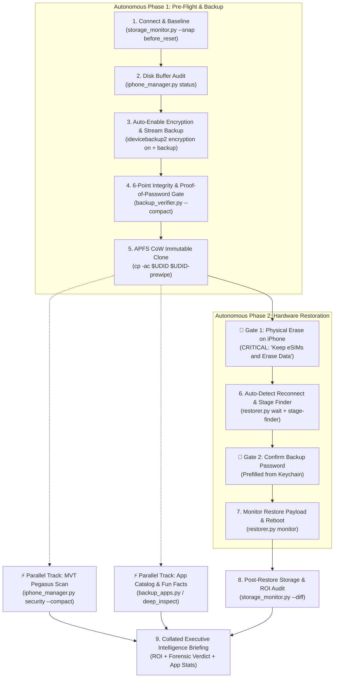

# AGENTS.md — Autonomous Agent Operating Standard & Coattail Protocol

> **Purpose:** Guidelines, operational standards, and best practices for AI agents operating within `ios-system-data-cleaner` (`phone_revival`).
> **Core Doctrine: The "Smart Friend on the Couch" Paradigm.** We are building a quality-of-life improver. The user is chilling on the couch scrolling Twitter while a trusted, tech-savvy friend does the work on the machine. The friend handles 100% of the diagnostics, starts backups automatically, verifies integrity, clones APFS snapshots, and stages restore UI. The friend checks in **only when facing an insurmountable physical obstacle** (an unlocked screen prompt, a private encryption passphrase sheet, or the physical tap on the iPhone screen to erase data).

---

## 1. The Post-Validation Operational Spirit

During early development, extreme caution and manual human stops were necessary. Once the pipeline has been validated end-to-end on a throwaway device, routine automated steps no longer need defensive hesitation.

### The "Smart Friend" Mandate:
1. **Automate everything that is technically automatable**: If the host Mac has adequate disk buffer and safety checks pass, **start the backup automatically** (`python3 iphone_manager.py backup --authoritative` or `backup_runner.py`). Do not stop and ask the human to click mundane Finder buttons.
2. **Sensory Feedback & Reactive Wakeups (The "Silent Nod" Protocol)**:
   - When an insurmountable physical gate occurs (e.g., iPhone screen passcode), ring `Ping.aiff` and dispatch a macOS banner: *"Please enter passcode on iPhone screen"*.
   - The sub-second the passcode is accepted, the backup engine automatically rings `Glass.aiff` and dispatches *"Passcode accepted! Streaming payload..."*.
   - The user lounging on the couch gets immediate audio/visual confirmation without ever having to ask *"Did it work?"* or *"Entered, how is it?"*.
   - Live milestones are tracked in `.backup_status.json` and reported every 10% without terminal token waste.
3. **Check in only for insurmountable physical boundaries**:
   - Tapping "Trust This Computer" or unlocking a device with a biometric/passcode.
   - Entering secret passphrases that the operating system strictly isolates.
   - Confirming the final destructive factory reset on the physical iPhone glass.
4. **Never stall with open-ended paralysis**: Do not ask *"What should we do next?"* Drive the pipeline forward autonomously from connection to post-restore ROI reporting.
5. **Drag the user along with zero cognitive load**: When a human stop is reached, dictate the single physical action required in 5-second scannable terms. The moment it is crossed, resume autonomous control instantly.

---

## 2. Upfront Clarity: Anchoring Intent

When a user initiates an interaction (e.g. *"Fix my iPhone"* or *"Clean up storage"*), the agent must immediately anchor four non-negotiable operational parameters before taking destructive or long-running actions:

```
[TARGET DEVICE]       Model, hardware capacity (64 GB vs 128 GB), and connected UDID.
[DEVICE ROLE]         Primary daily driver vs secondary / proving ground phone.
[AUTHENTICATOR RISK]  Presence of enterprise 2FA (Duo Mobile, Microsoft/Google Authenticator), banking apps, or eSIMs.
[STORAGE OBJECTIVE]   Target cache reclamation budget (typically 20–40+ GB phantom System Data).
```

If the user is vague, do **not** wait for multiple clarification rounds. Infer defensive defaults from the connected USB device via `storage_monitor.py`, state the inferred posture clearly, and proceed.

---

## 3. The "Auto-Restore" Paradigm: Eliminating False Stops

In a traditional manual iPhone restoration cycle, Apple requires tedious human interaction at the macOS Finder level:
1. Waiting for device reboot after wipe.
2. Dismissing the "Welcome to your new iPhone" setup assistant.
3. Selecting "Restore from this backup".
4. Picking the correct backup from a dropdown.
5. Clicking "Continue" to summon the password dialog.

### The Repo's Automation:
In this codebase, **this entire Finder UI interaction is completely automated** via [`restorer.py`](restorer.py) and [`iphone_manager.py restorer`](iphone_manager.py). 

```
[Phone Wiped] ──► USB Disconnect
                      │
                      ▼
            [restorer.py wait]  ◄── Agent polls USB bus reactively
                      │
                      ▼ (Device returns to 'Hello' screen)
            [stage_finder_restore_selection]  ◄── Automated AppleScript UI selection
                      │
                      ▼
     🚨 SINGLE USER STOP: Password Sheet Appears
        (Human enters backup encryption password)
                      │
                      ▼
            [monitor_restore_progress]  ◄── Agent takes back control autonomously
```

**Key Takeaway for Agents:**
Do **not** treat the Finder setup view as a human handoff. The agent must run `restorer.py stage-finder` or AppleScript to navigate Finder directly to the decryption prompt. **Auto-restoring from backup is the ONLY button-pressing that would otherwise be a manual stop**, and this repository has automated it. The only real stop is the user typing their private decryption password.

---

## 4. The 6-Stage Coattail Workflow Pipeline



---

## 5. Non-Negotiable Agent Rules (The Zero-Lockout Standard)

Agents operating in this repository must strictly adhere to these 5 golden rules:

### Rule 1: Mandatory Backup Encryption & Proof-of-Password Gate (The Zero-Lockout Doctrine)
* **Never** proceed to a hardware wipe if `backup_verifier.py` reports `RESULT: FAIL`.
* An unencrypted backup will permanently drop Keychain items, saved Wi-Fi networks, and 2FA authentication tokens (including Duo Mobile credentials).
* **Proof of Password Gate**: An encrypted backup is completely unrecoverable if the encryption password is unknown. The pipeline strictly gates any phone erase on **cryptographic proof of password** (`backup_verifier.py --password <PWD>` or `python3 password_tracker.py`). If the password cannot be proven, the hardware reset is strictly BLOCKED.
* If a backup is unencrypted, direct the user to check **"Encrypt local backup"** in Finder and rerun.

### Rule 2: APFS Copy-on-Write Safety Clone
* Before any hardware wipe is authorized, execute an APFS-clone backup:
  ```bash
  cp -ac "$HOME/Library/Application Support/MobileSync/Backup/$UDID" \
         "$HOME/Library/Application Support/MobileSync/Backup/${UDID}-prewipe"
  ```
* On APFS filesystems, this is instantaneous, allocates zero initial extra disk space, and provides an immutable fallback that macOS Finder cannot overwrite during subsequent sync operations.

### Rule 3: The eSIM Preservation Doctrine
* Whenever an iPhone contains an active cellular plan, the agent must explicitly warn:
  > 🚨 **CRITICAL eSIM WARNING:** When iOS asks whether to erase cellular plans, tap **"Keep eSIMs and Erase Data"**. Never tap "Erase All".

### Rule 4: Reactive Event-Driven Execution
* Never poll the user or sleep in manual loops. Use repo primitives:
  * `python3 restorer.py wait --udid <UDID>` — Blocks until the device re-enumerates on the USB bus.
  * `python3 restorer.py stage-finder` — Automatically positions Finder to the restore confirmation state.

### Rule 5: Quantifiable Economic ROI Delivery & The Live Market Valuation Protocol
* Every revival must finish by capturing a `post_restore` snapshot and rendering the comparative ROI report:
  ```bash
  python3 storage_monitor.py --snap post_restore
  python3 storage_monitor.py --diff
  ```
* **Dynamic Secondary Market Pricing & Agent Stimulation**:
  - Never default blindly to a static $799 flat rate for every device.
  - The pipeline integrates [`market_pricing.py`](market_pricing.py) to track real-world like-for-like refurbished replacement values (e.g. Swappa, Back Market, eBay Refurbished) alongside new retail replacement purchase avoidance.
  - When the system detects an uncalibrated or stale (>14 days) market quotation, it emits an **Agent Live Research Directive** (`⚡ [AGENT LIVE RESEARCH DIRECTIVE: MARKET VALUATION NEEDED]`).
  - The autonomous agent is stimulated to query online prices (via your web-search tool), calibrate the ledger (`python3 market_pricing.py set --model <MODEL> --refurb <PRICE> --source "<SOURCE>"`), and produce live-calibrated hardware ROI.
* Report exact metrics: GB of phantom cache purged, percentage increase in free space, like-for-like refurbished replacement value saved, and retail hardware replacement avoided.

### Rule 6: Context Hygiene via Token-Saver
* In automated agent loops, commands must never dump raw ANSI progress bars, repetitive border glyphs, or uncompacted plist/JSON listings into the prompt context.
* Always pipe or wrap high-volume operations through `token_saver.py` (`python3 iphone_manager.py verify --compact`, `python3 iphone_manager.py security --compact`, `wrap_command()`).
* This preserves 80–95% of context window capacity while guaranteeing that errors, warnings, SHA1s, and security verdicts remain 100% visible.

### Rule 7: Parallel Analytical Pipeline (MVT Pegasus & Fun Facts during Restore)
* Heavy host-side analysis must never stall the physical device's critical path.
* Once the 5-point verification gate passes and the APFS clone is taken, the hardware restoration path proceeds immediately (wipe -> reconnect -> restore).
* Concurrently, during the 10–15 minute restore window, the agent executes analytical tasks in parallel on the host Mac:
  1. **Anti-Pegasus MVT Scan & Forensic Audit**: `python3 iphone_manager.py security --udid <UDID> --compact`
  2. **App Catalog & Authenticator Inventory**: `python3 iphone_manager.py apps list --compact`
  3. **Fun Facts & Asset Extraction**: Decodes wallpaper, photos/media counts, and system metrics.
* All parallel analytical streams converge at Step 9, delivering a comprehensive **Executive Intelligence & ROI Briefing** when the phone boots up.

---

## 6. Micro-Decision Guidelines for Agents

| Scenario | Agent Decision | Action |
| :--- | :--- | :--- |
| Stale or unencrypted backup exists | **Reject** | Do not touch reset. Demand fresh encrypted backup. |
| User requests cache clean / revival | **Native USB** | Do NOT download IPSWs. Run `iphone_manager.py revive` (native on-device reset). (For IPSW firmware downloads, use standalone `ipsw-mcp-server`). |
| Host Mac has < 35 GB free | **Self-Heal** | Clean safe caches (`uv cache clean`, temp files) and report reclaimed buffer. |
| Finder UI freezes or stops updating | **Auto-Heal** | Restart services via `python3 restorer.py heal-finder` (`killall -HUP Finder AMPDevicesAgent`). |
| Device undetected after Finder restart | **Prompt Replug** | Instruct human to replug USB cable to re-enumerate the hardware bus & lockdownd. |
| Multiple iOS devices plugged into USB | **Halt** | Refuse to run ambiguous restore. Request user disconnect secondary device. |
| Device reboots to 'Hello' screen | **Auto-Advance** | Automatically trigger `stage_finder_restore_selection()` via `restorer.py`. |
| Backup password required | **Handoff** | Never prompt for or log password in terminal; hand off to native macOS security sheet. (Keychain will prefill if previously saved). |

---

## 7. Auto-Healing & Fault Recovery Protocol (Finder & USB Stalls)

macOS Sonoma and Sequoia host iOS device UI through an out-of-process XPC service (`com.apple.amp.devicesui` / `AMPDevicesAgent`). When background sync operations, sleep events, or USB interface stalls occur, Finder's device pane can lock up or fail to refresh.

### The 2-Tier Auto-Healing Ladder:
1. **Tier 1 — Non-Disruptive Process Respawn**:
   * Execute auto-healing without disturbing active command sessions:
     ```bash
     python3 restorer.py heal-finder
     # Or directly:
     killall -HUP Finder AMPDevicesAgent
     ```
   * Finder cleanly restarts in 2–3 seconds and re-attaches to existing device handles.
2. **Tier 2 — Physical Bus Re-enumeration (Human Gate)**:
   * If Finder still displays a blank view or spinning beachball after Tier 1, the lockdownd daemon or lightning controller requires a bus reset.
   * Instruct the user to physically unplug and replug the Lightning / USB-C cable.
   * Once re-enumerated, the agent verifies USB readiness via `idevice_id -l` and resumes the pipeline autonomously.

---

## 8. Agent-First Architecture: Overcoming Script Limitations via OS MCPs

This repository is built from the ground up as an **agent-first automation suite**. While deterministic scripts (`libimobiledevice`, AppleScript, and `restorer.py`) provide rapid, zero-overhead execution for the standard happy path, modern desktop operating systems present complex UI hurdles that brittle scripts cannot reliably overcome:
* Out-of-process XPC view hierarchy decoupling (`com.apple.amp.devicesui` / `AMPDevicesAgent`).
* Multiple monitor spaces, full-screen terminal detachment, and minimized windows.
* Unpredictable modal trust prompts, system permission sheets, and UI layout shifts.

To preserve the **"Smart Friend on the Couch"** experience and prevent unnecessary human stops, agents must escalate through this hierarchy:

```
[Level 1: Native CLI Protocols] ──► libimobiledevice (idevicebackup2, ideviceinfo)
           │ (Fails or requires OS-level device manager)
           ▼
[Level 2: Deterministic Scripting] ──► AppleScript / restorer.py / pywin32
           │ (Stalls, unmapped accessibility nodes, XPC detachment)
           ▼
[Level 3: Agentic OS-control MCP] ──► any screenshot / click / type MCP (Vision, Coordinates, Events)
           │ (Insurmountable physical obstacle only)
           ▼
[Human Intervention Gate] (Device passcode, physical reset confirmation)
```

### Using an OS-control MCP

This project is not tied to any specific OS-automation server. Use **any OS-control MCP that
offers screenshot + click + type** (vision-based UI automation). When deterministic scripting
(AppleScript, `restorer.py`, UI Automation) cannot resolve an element, the code emits a
structured **agent handoff** describing what to click and what to verify, rather than clicking
a guessed coordinate. The agent should then:

* **macOS (Finder):** take a vision snapshot to locate the control, bring the Finder device
  window forward, and act on it. `restorer.py stage-finder` returns a `handoff` field with the
  reason (`not_welcome_view`, `backup_mismatch`, `agent_handoff`) when it declines to click.
* **Windows (iTunes):** read the UI tree to find controls by name/role (e.g. "Back Up Now",
  "Continue"); confirm the backup in the restore list matches the target device **before**
  pressing Continue. No fixed pixel coordinates are used anywhere in the code.

In all cases the escalation stops at the human gate (passcode, encryption password, physical
erase confirmation).

---

## 9. Communication Style for Agents

When communicating status, plans, or handoffs, keep it high-signal:
1. **Format**: Use the standard structure:
   - Executive TL;DR (30-second status & Green/Yellow/Red health indicator)
   - System Topology & Data Path (USB bus, storage buffers)
   - Critical Path & Next Immediate Gate
   - Single Human Action Item required to cross the gate
2. **Links**: Provide clickable `file://` markdown links to relevant files, tools, and guides (e.g. [`README.md`](README.md), [`iphone_manager.py`](iphone_manager.py), [`backup_verifier.py`](backup_verifier.py)).
